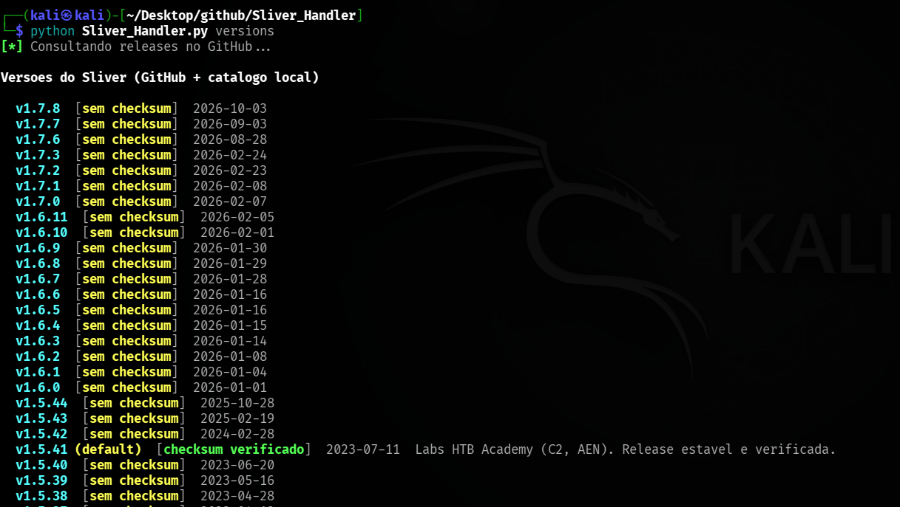
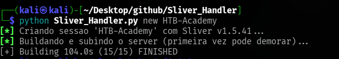
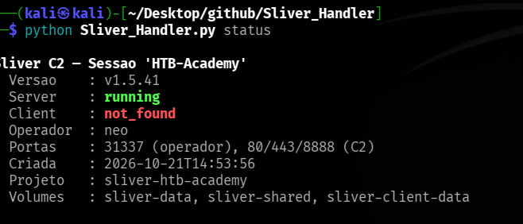
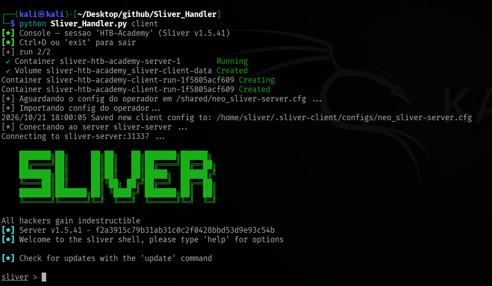
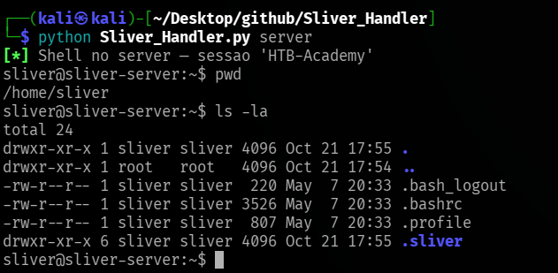
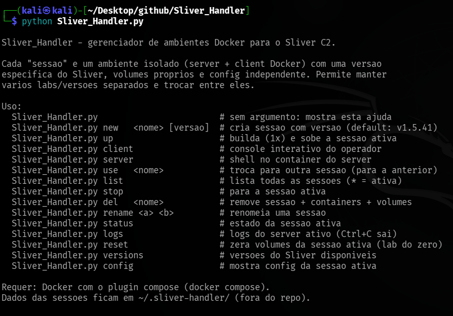

<p align="center">
  
</p>

<h1 align="center">Sliver_Handler</h1>

<p align="center">
  <strong>Gerenciador de ambientes Docker para o Sliver C2.</strong><br>
  Mantém várias versões/labs do Sliver isolados — cada sessão é um ambiente Docker
  completo (server + client + volumes próprios) — e troca entre eles com um comando.
</p>

<p align="center">
  <em>Feito por <strong>Avocado</strong> · equipe <strong>Caramelo Storm</strong></em><br>
  <a href="https://www.linkedin.com/in/rafael-raugi/">💼 LinkedIn</a> ·
  <a href="https://www.youtube.com/@avocado-shell">📺 YouTube @avocado-shell</a>
</p>

---

Plataformas como o **HTB Academy** fixam o Sliver em uma versão específica (ex: `v1.5.41`),
enquanto o repositório oficial já está várias releases à frente. Instalar pelo `apt` ou
compilar o `main` quebra a compatibilidade com o lab. O `Sliver_Handler` resolve isso:
cada **sessão** é um par de containers Docker (server + client) com uma **versão fixada**
do Sliver, baixada do binário oficial da release e **verificada por SHA-256**. Você cria
sessões com versões diferentes, troca entre elas e cada uma mantém seus próprios
certificados, config de operador, banco e implantes gerados — **sem conflito**.

> 🔒 **Persistência e isolamento:** cada sessão roda como um Docker Compose project
> separado (`--project-name`) com volumes próprios. Os dados ficam nos volumes Docker
> e os metadados em `~/.sliver-handler/` (fora do repo). Ao deletar uma sessão,
> containers e volumes são removidos juntos.

## O que ele faz

- **Sessões nomeadas** — cada lab/curso/versão num ambiente Docker isolado.
- **Multi-versão** — rode `v1.5.41` para o HTB Academy e `v1.7.8` para outro lab, cada
  um com seus próprios certificados, operadores e implantes.
- **Troca atômica** — `use <nome>` para a sessão atual e sobe a outra.
- **Catálogo de versões** — consulta as releases do Sliver direto do GitHub e marca
  quais têm checksum verificado no catálogo local.

<p align="center">
  
  <br><sub><code>versions</code> — consulta a API do GitHub e marca a <code>v1.5.41</code> como <strong>checksum verificado</strong>.</sub>
</p>

- **Integridade** — versões conhecidas são verificadas por SHA-256 durante o build;
  versões novas funcionam mas avisam que não há checksum cadastrado.
- **Dois consoles** — `client` abre o console do operador (`sliver >`), `server`
  abre o console do server (`[server] sliver >`) com comandos de admin como
  `new-operator` e `multiplayer`. `shell` dá bash direto no container para debug.
- **Python 3 stdlib** — sem dependências externas, só Docker.

## Como rodar

```bash
cd Sliver_Handler

# Veja as versoes disponiveis (consulta o GitHub)
./Sliver_Handler.py versions

# Crie uma sessao para o lab do HTB (v1.5.41, default)
./Sliver_Handler.py new htb-academy

# Crie outra sessao com versao diferente
./Sliver_Handler.py new lab-novo v1.7.8

# Liste as sessoes (* = ativa)
./Sliver_Handler.py list

# Troque de sessao (para a atual, sobe a outra)
./Sliver_Handler.py use htb-academy

# Abra o console do operador
./Sliver_Handler.py client

# Shell no server (debug, checar certs, gerar operadores)
./Sliver_Handler.py server
```

No console do Sliver, comece um listener e gere um implante:

```
sliver > mtls --lport 443
sliver > generate --mtls sliver-server:443 --os windows --save /shared/implant.exe
sliver > jobs
```

<p align="center">
  
  <br><sub>Criando a sessão <code>HTB-Academy</code> com Sliver <code>v1.5.41</code> — build + server no ar em um comando.</sub>
</p>

<p align="center">
  
  <br><sub>Estado da sessão ativa: versão, server <strong>running</strong>, operador, portas e volumes.</sub>
</p>

<p align="center">
  
  <br><sub>Console do operador — o client importa o config, conecta e abre o shell do Sliver.</sub>
</p>

<p align="center">
  
  <br><sub><code>shell</code> — bash no container do server para debug e checar arquivos.</sub>
</p>

## Comandos

<p align="center">
  
  <br><sub>Ajuda do Sliver_Handler (<code>./Sliver_Handler.py</code> sem argumentos ou <code>help</code>).</sub>
</p>

| Comando | Ação |
|---------|------|
| `new <nome> [versao]` (`create`) | Cria sessão com versão do Sliver (default: `v1.5.41`) e sobe |
| `up` (`start`) | Builda (1x) e sobe a sessão ativa |
| `client` (`console`, `c`) | Console interativo do operador na sessão ativa |
| `server` (`srv`, `s`) | Console do server (`[server] sliver >` com `new-operator`, etc.) |
| `shell` (`bash`, `sh`) | Bash no container do server (debug, checar certs) |
| `use <nome>` (`switch`) | Troca para outra sessão (para a anterior, sobe a nova) |
| `list` (`ls`) | Lista todas as sessões (`*` = ativa) com versão e estado |
| `stop` (`down`) | Para os containers da sessão ativa (volumes preservados) |
| `del <nome>` (`rm`, `delete`) | Remove sessão + containers + volumes |
| `rename <a> <b>` (`mv`) | Renomeia uma sessão |
| `status` (`st`) | Estado detalhado da sessão ativa |
| `logs` (`log`) | Logs do server ativo (`Ctrl+C` sai) |
| `reset` (`nuke`) | Zera volumes da sessão ativa (lab do zero, pede confirmação) |
| `versions` (`ver`) | Lista releases do Sliver (GitHub + catálogo local) |
| `config` (`env`) | Mostra config (`.env`) da sessão ativa |
| `help` | Ajuda |

## Requisitos

- **Docker** com o plugin **Compose v2**: `sudo apt install docker.io docker-compose-plugin`
- Usuário no grupo `docker`: `sudo usermod -aG docker $USER` (ou rode com `sudo`)
- **Python 3** (stdlib apenas — **sem dependências externas**)
- Arquitetura **x86-64** (a release `v1.5.41` só publica binário Linux amd64)

## Como funciona (resumo técnico)

1. **Sessão = Docker Compose project** — cada sessão roda com `--project-name sliver-<nome>`
   e `--env-file` próprio, gerando containers e volumes isolados automaticamente.
2. **Versão fixada por binário oficial** — os Dockerfiles baixam o `sliver-server_linux` e
   `sliver-client_linux` da release no GitHub e verificam o SHA-256 no build.
3. **Catálogo de versões** — checksums conhecidos ficam hardcoded no script; versões extras
   podem ser adicionadas em `~/.sliver-handler/versions.json`. O comando `versions` consulta
   a API do GitHub para listar todas as releases disponíveis.
4. **Server entrypoint** — na primeira execução, descompacta os assets embutidos no binário
   (`unpack`), gera o config do operador e sobe o daemon multiplayer. O client espera o
   config aparecer em `/shared`, importa e conecta.
5. **Uma sessão por vez** — ao trocar (`use`), a sessão atual para antes da nova subir,
   evitando conflito de portas.

## Portas / listeners C2

| Porta | Uso |
|-------|-----|
| `31337` | Canal do operador (multiplayer) |
| `80` | Listener C2 HTTP |
| `443` | Listener C2 HTTPS / mTLS |
| `8888` | Listener C2 extra |

Todas publicadas no host. Ao criar um listener no console (`mtls`, `http`, `https`),
use uma dessas portas para que o implante alcance o server de fora do Docker.

## Estrutura

```
Sliver_Handler.py              gerenciador (Python 3, stdlib)
docker/
  ├── docker-compose.yml       orquestra server + client
  ├── server/
  │   ├── Dockerfile           baixa sliver-server da release (+ SHA-256)
  │   └── entrypoint.sh        unpack → gera config → daemon
  └── client/
      ├── Dockerfile           baixa sliver-client da release (+ SHA-256)
      └── entrypoint.sh        espera config → import → console

~/.sliver-handler/             (criado em runtime; NÃO versionado)
  ├── active                   nome da sessão ativa
  ├── versions.json            versões extras (opcional)
  └── sessions/<nome>/
      ├── meta.json            nome, versão, timestamps
      └── .env                 config do docker compose da sessão
```

## Aviso

Ferramenta de apoio a **operações ofensivas autorizadas** e **labs de estudo**.
O Sliver C2 é um projeto GPLv3 do BishopFox — esta ferramenta apenas orquestra
a execução em containers Docker. Você é responsável pelo uso.

## Licença

[MIT](LICENSE) — uso autorizado apenas em assessments com autorização por escrito
e em ambientes de laboratório/estudo.

---

<p align="center">
  <sub>⚡ <strong>Caramelo Storm</strong> ·
  <a href="https://www.linkedin.com/in/rafael-raugi/">LinkedIn</a> ·
  <a href="https://www.youtube.com/@avocado-shell">YouTube @avocado-shell</a></sub>
</p>
